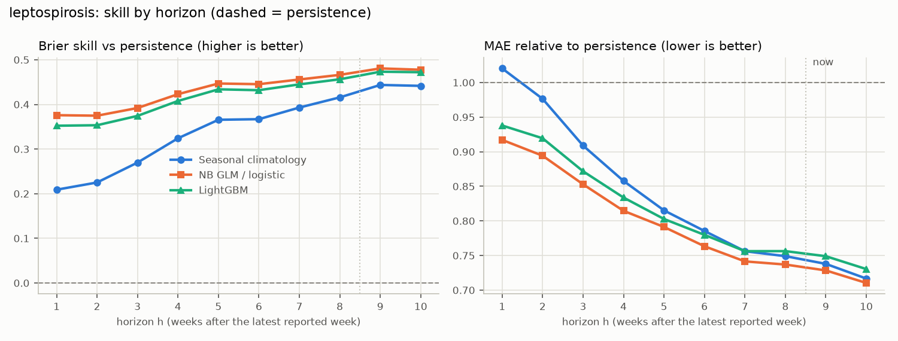
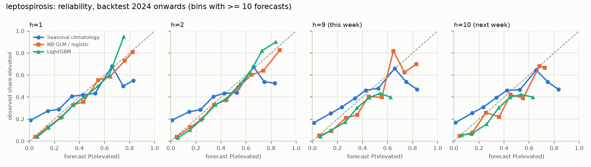
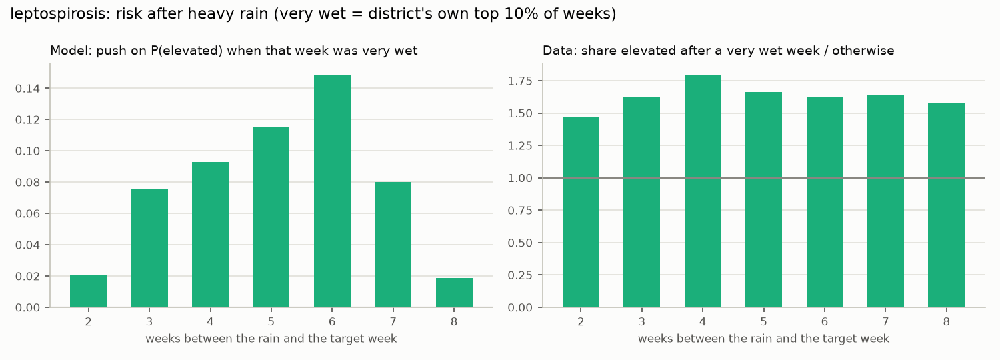
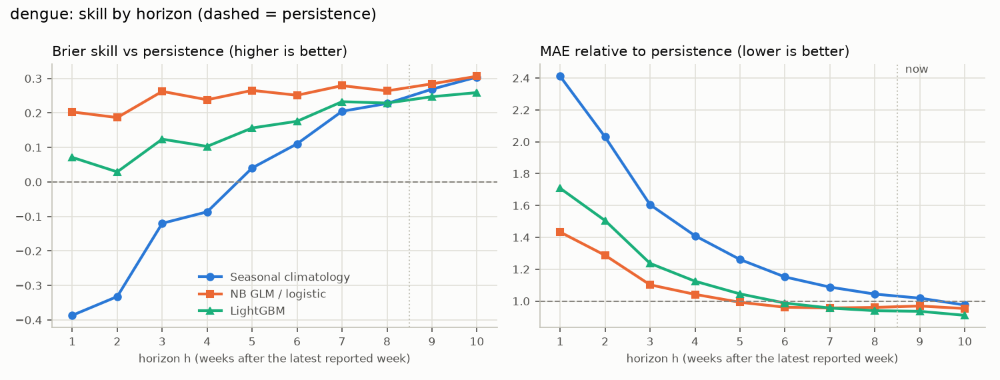
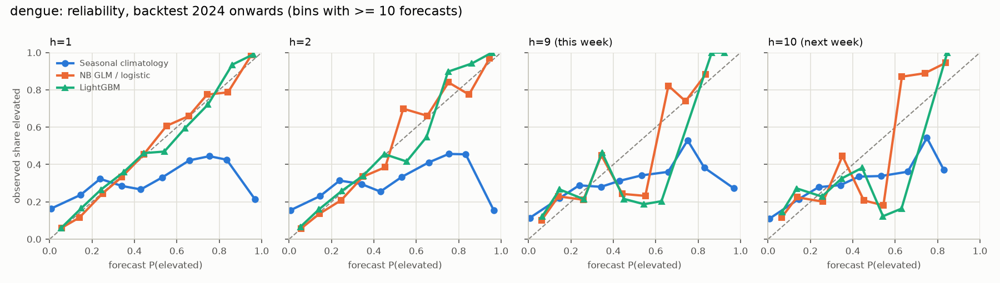
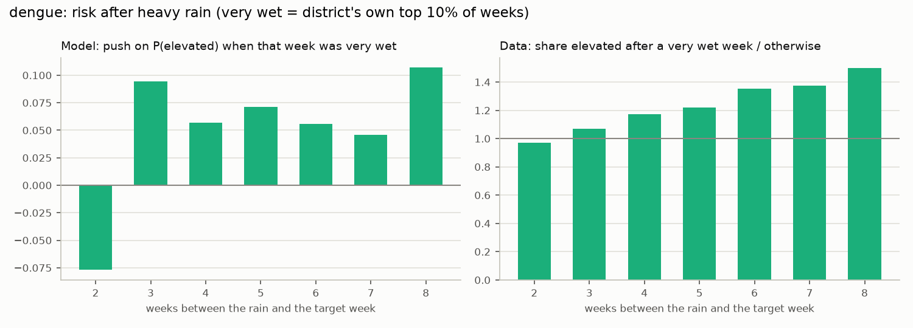

# Outlook backtest

Generated 2026-11-03 by `python -m radar_lk.outlook.backtest`. Primary data: Epidemiology Unit, Ministry of Health, Sri Lanka (WER Table 1, `extraction_valid` RDHS rows, weekly counts as first printed); rainfall, temperature and humidity: Open-Meteo (CC BY 4.0); external check: National Dengue Control Unit (NDCU) Weekly Dengue Update. This is the proposal's fallback after the NDCU MOH outlook was judged NO-GO: a district-level outlook, leptospirosis primary, dengue secondary, from one disease-agnostic engine. Outputs are population-level signals for planning, not predictions about any person.

## Design: filling the publication gap

- The WER reports a week about **L = 8 weeks** after it ends (`publication_lag_weeks`, measured from the PDFs). Rainfall is observed in near real time. From the latest reported week t (the origin) the outlook forecasts t+1 .. t+10: at the time of use (about t+8) h = 9 is **this week** and h = 10 **next week**; h = 1, 2 are the proposal's horizons (weeks already over but not yet reported).
- Targets: (i) the weekly count; (ii) **elevated** = count >= that district's 80th percentile of its counts in the 104 weeks before t (past-only), floored at 1 case.
- Features: counts y_t..y_t-3, 4- and 8-week means, same week last year, mean count of neighbouring districts at t (HDX polygons; Kalmunai adjacent to Ampara and Batticaloa by rule, `config/district_adjacency.csv`), reporting completeness at t, district, h, Fourier terms of the target's week of year, and weather relative to the TARGET week: rain at lags 2..8, the 4-week rain sum ending at lag 2, mean temperature and humidity at lags 2-4. Lag >= 2 is enforced in code (`features.weather_at`) and tested; for targets up to now + 2 all of it is observed at the time of use.
- Models (fixed settings, nothing tuned on test data): persistence; seasonal climatology (district mean / elevated frequency for the target's week of year +-1 in earlier years); NB GLM (counts) / L2 logistic regression (class); LightGBM (Poisson / binary).
- Rolling origin, expanding window: test origins 2024-W01 to the latest week, refit every 4 weeks on rows whose target week is <= the refit origin. 2023 origins are forecast too but only to fill the calibration pools.
- Uncertainty: counts, rolling split-conformal on past-only residuals normalised by sqrt(pred + 1), pool = the last 52 origins with observed targets, same model and horizon (80% and 90%). Probabilities (GLM and LightGBM): inductive **Venn-Abers** (`venn-abers` package) on the same pool; `p_elevated` is the calibrated probability and [`p_lo`, `p_hi`] its Venn-Abers range. Baselines keep their own probability.
- Skill: MASE = MAE / persistence MAE on the same rows; BSS = 1 - Brier / reference Brier; recall and precision at p >= 0.5. Every model is scored on the same district-weeks.

## Leptospirosis

Test origins 2024-W01 to 2026-W32 (136 origins x 26 districts x up to 10 horizons).

### Headline: Brier skill vs persistence (BSS), MASE vs persistence, 90% interval coverage

| model | h=1 BSS | h=1 MASE | h=1 cov90 % | h=2 BSS | h=2 MASE | h=2 cov90 % | h=9 (this week) BSS | h=9 (this week) MASE | h=9 (this week) cov90 % | h=10 (next week) BSS | h=10 (next week) MASE | h=10 (next week) cov90 % |
|---|---|---|---|---|---|---|---|---|---|---|---|---|
| Persistence | 0.00 | 1.00 | 90.38 | 0.00 | 1.00 | 90.87 | 0.00 | 1.00 | 91.66 | 0.00 | 1.00 | 91.99 |
| Seasonal climatology | 0.21 | 1.02 | 91.90 | 0.23 | 0.98 | 92.10 | 0.44 | 0.74 | 93.61 | 0.44 | 0.72 | 93.68 |
| NB GLM / logistic | 0.38 | 0.92 | 91.38 | 0.37 | 0.89 | 92.13 | 0.48 | 0.73 | 93.58 | 0.48 | 0.71 | 93.90 |
| LightGBM | 0.35 | 0.94 | 91.32 | 0.35 | 0.92 | 91.75 | 0.47 | 0.75 | 93.24 | 0.47 | 0.73 | 93.53 |

### Stop rule: does LightGBM beat persistence?

Where it does not, the dashboard uses the best baseline at that horizon (and says so).

| h | lightgbm beats persistence (count) | lightgbm beats persistence (class) | dashboard count model | dashboard class model |
|---|---|---|---|---|
| 1 | True | True | lightgbm | lightgbm |
| 2 | True | True | lightgbm | lightgbm |
| 3 | True | True | lightgbm | lightgbm |
| 4 | True | True | lightgbm | lightgbm |
| 5 | True | True | lightgbm | lightgbm |
| 6 | True | True | lightgbm | lightgbm |
| 7 | True | True | lightgbm | lightgbm |
| 8 | True | True | lightgbm | lightgbm |
| 9 | True | True | lightgbm | lightgbm |
| 10 | True | True | lightgbm | lightgbm |

LightGBM beats persistence on both targets at every horizon.

### Counts, every horizon

| model | h | n | MAE | RMSE | MASE vs persistence | coverage80 % | width80 | coverage90 % | width90 |
|---|---|---|---|---|---|---|---|---|---|
| LightGBM | 1 | 3432 | 4.289 | 7.380 | 0.938 | 81.090 | 10.897 | 91.317 | 15.505 |
| NB GLM / logistic | 1 | 3432 | 4.194 | 7.220 | 0.917 | 81.381 | 10.953 | 91.375 | 15.154 |
| Persistence | 1 | 3432 | 4.573 | 7.626 | 1.000 | 81.061 | 11.955 | 90.385 | 16.339 |
| Seasonal climatology | 1 | 3432 | 4.666 | 8.258 | 1.020 | 83.013 | 12.211 | 91.900 | 17.102 |
| LightGBM | 2 | 3406 | 4.376 | 7.545 | 0.919 | 81.562 | 11.220 | 91.750 | 16.029 |
| NB GLM / logistic | 2 | 3406 | 4.256 | 7.356 | 0.894 | 82.501 | 11.359 | 92.132 | 15.737 |
| Persistence | 2 | 3406 | 4.760 | 8.181 | 1.000 | 81.122 | 12.332 | 90.869 | 16.954 |
| Seasonal climatology | 2 | 3406 | 4.648 | 8.242 | 0.976 | 83.294 | 12.255 | 92.102 | 17.171 |
| LightGBM | 3 | 3380 | 4.436 | 7.710 | 0.872 | 82.367 | 11.420 | 92.337 | 16.399 |
| NB GLM / logistic | 3 | 3380 | 4.340 | 7.458 | 0.853 | 82.722 | 11.611 | 92.367 | 16.272 |
| Persistence | 3 | 3380 | 5.089 | 8.698 | 1.000 | 81.361 | 13.104 | 90.799 | 18.046 |
| Seasonal climatology | 3 | 3380 | 4.625 | 8.216 | 0.909 | 83.698 | 12.307 | 92.219 | 17.252 |
| LightGBM | 4 | 3354 | 4.463 | 7.773 | 0.834 | 82.618 | 11.603 | 92.308 | 16.725 |
| NB GLM / logistic | 4 | 3354 | 4.361 | 7.512 | 0.815 | 82.976 | 11.735 | 92.606 | 16.540 |
| Persistence | 4 | 3354 | 5.353 | 9.064 | 1.000 | 80.918 | 13.605 | 90.877 | 18.526 |
| Seasonal climatology | 4 | 3354 | 4.592 | 8.159 | 0.858 | 84.109 | 12.363 | 92.576 | 17.342 |
| LightGBM | 5 | 3328 | 4.488 | 7.804 | 0.803 | 82.843 | 11.694 | 92.488 | 16.887 |
| NB GLM / logistic | 5 | 3328 | 4.424 | 7.620 | 0.791 | 83.263 | 12.158 | 92.969 | 17.037 |
| Persistence | 5 | 3328 | 5.591 | 9.422 | 1.000 | 81.310 | 14.576 | 90.685 | 19.517 |
| Seasonal climatology | 5 | 3328 | 4.558 | 8.123 | 0.815 | 84.525 | 12.425 | 92.939 | 17.440 |
| LightGBM | 6 | 3302 | 4.482 | 7.803 | 0.780 | 83.041 | 11.829 | 92.974 | 17.047 |
| NB GLM / logistic | 6 | 3302 | 4.387 | 7.599 | 0.763 | 83.495 | 12.173 | 93.065 | 17.130 |
| Persistence | 6 | 3302 | 5.747 | 9.676 | 1.000 | 81.102 | 14.616 | 90.612 | 19.821 |
| Seasonal climatology | 6 | 3302 | 4.514 | 8.062 | 0.785 | 85.130 | 12.491 | 93.216 | 17.543 |
| LightGBM | 7 | 3276 | 4.508 | 7.837 | 0.756 | 83.303 | 11.957 | 93.010 | 17.347 |
| NB GLM / logistic | 7 | 3276 | 4.420 | 7.669 | 0.742 | 83.639 | 12.393 | 93.254 | 17.493 |
| Persistence | 7 | 3276 | 5.960 | 9.976 | 1.000 | 81.532 | 15.296 | 91.209 | 20.850 |
| Seasonal climatology | 7 | 3276 | 4.507 | 8.057 | 0.756 | 85.348 | 12.559 | 93.315 | 17.651 |
| LightGBM | 8 | 3250 | 4.544 | 7.907 | 0.756 | 83.477 | 12.084 | 93.508 | 17.600 |
| NB GLM / logistic | 8 | 3250 | 4.427 | 7.690 | 0.737 | 84.308 | 12.500 | 93.754 | 17.747 |
| Persistence | 8 | 3250 | 6.007 | 9.957 | 1.000 | 81.231 | 15.363 | 91.354 | 20.875 |
| Seasonal climatology | 8 | 3250 | 4.500 | 8.062 | 0.749 | 85.538 | 12.636 | 93.446 | 17.757 |
| LightGBM | 9 | 3224 | 4.555 | 7.935 | 0.749 | 83.592 | 12.213 | 93.238 | 17.686 |
| NB GLM / logistic | 9 | 3224 | 4.430 | 7.737 | 0.728 | 84.615 | 12.644 | 93.579 | 17.889 |
| Persistence | 9 | 3224 | 6.081 | 10.225 | 1.000 | 81.576 | 15.538 | 91.656 | 21.362 |
| Seasonal climatology | 9 | 3224 | 4.487 | 8.057 | 0.738 | 85.856 | 12.717 | 93.610 | 17.868 |
| LightGBM | 10 | 3198 | 4.567 | 8.008 | 0.730 | 84.115 | 12.359 | 93.527 | 17.884 |
| NB GLM / logistic | 10 | 3198 | 4.442 | 7.776 | 0.710 | 84.615 | 12.674 | 93.902 | 18.211 |
| Persistence | 10 | 3198 | 6.253 | 10.611 | 1.000 | 81.926 | 16.061 | 91.995 | 22.632 |
| Seasonal climatology | 10 | 3198 | 4.482 | 8.064 | 0.717 | 86.085 | 12.792 | 93.684 | 17.976 |

### Elevated, every horizon

| model | h | n_class | base rate % | Brier | BSS vs persistence | BSS vs climatology | recall | precision | AUROC | PR-AUC | mean p range |
|---|---|---|---|---|---|---|---|---|---|---|---|
| LightGBM | 1 | 3432 | 27.885 | 0.172 | 0.352 | 0.181 | 0.327 | 0.544 | 0.745 | 0.516 | 0.015 |
| NB GLM / logistic | 1 | 3432 | 27.885 | 0.166 | 0.376 | 0.211 | 0.388 | 0.606 | 0.764 | 0.554 | 0.017 |
| Persistence | 1 | 3432 | 27.885 | 0.265 | 0.000 | -0.264 | 0.532 | 0.524 | 0.672 | 0.409 |  |
| Seasonal climatology | 1 | 3432 | 27.885 | 0.210 | 0.209 | 0.000 | 0.149 | 0.498 | 0.631 | 0.399 |  |
| LightGBM | 2 | 3406 | 27.892 | 0.175 | 0.353 | 0.166 | 0.280 | 0.567 | 0.732 | 0.500 | 0.016 |
| NB GLM / logistic | 2 | 3406 | 27.892 | 0.169 | 0.375 | 0.193 | 0.311 | 0.583 | 0.754 | 0.532 | 0.016 |
| Persistence | 2 | 3406 | 27.892 | 0.271 | 0.000 | -0.290 | 0.522 | 0.514 | 0.666 | 0.402 |  |
| Seasonal climatology | 2 | 3406 | 27.892 | 0.210 | 0.225 | 0.000 | 0.151 | 0.498 | 0.630 | 0.399 |  |
| LightGBM | 3 | 3380 | 27.751 | 0.178 | 0.374 | 0.143 | 0.271 | 0.502 | 0.720 | 0.472 | 0.015 |
| NB GLM / logistic | 3 | 3380 | 27.751 | 0.173 | 0.392 | 0.167 | 0.302 | 0.490 | 0.741 | 0.509 | 0.016 |
| Persistence | 3 | 3380 | 27.751 | 0.285 | 0.000 | -0.369 | 0.501 | 0.487 | 0.649 | 0.382 |  |
| Seasonal climatology | 3 | 3380 | 27.751 | 0.208 | 0.270 | 0.000 | 0.152 | 0.500 | 0.633 | 0.398 |  |
| LightGBM | 4 | 3354 | 27.698 | 0.181 | 0.408 | 0.124 | 0.290 | 0.457 | 0.713 | 0.444 | 0.014 |
| NB GLM / logistic | 4 | 3354 | 27.698 | 0.177 | 0.423 | 0.146 | 0.335 | 0.468 | 0.731 | 0.476 | 0.017 |
| Persistence | 4 | 3354 | 27.698 | 0.306 | 0.000 | -0.479 | 0.470 | 0.450 | 0.625 | 0.358 |  |
| Seasonal climatology | 4 | 3354 | 27.698 | 0.207 | 0.324 | 0.000 | 0.157 | 0.510 | 0.637 | 0.401 |  |
| LightGBM | 5 | 3328 | 27.524 | 0.183 | 0.434 | 0.107 | 0.272 | 0.470 | 0.702 | 0.424 | 0.013 |
| NB GLM / logistic | 5 | 3328 | 27.524 | 0.179 | 0.447 | 0.128 | 0.266 | 0.443 | 0.720 | 0.445 | 0.015 |
| Persistence | 5 | 3328 | 27.524 | 0.323 | 0.000 | -0.576 | 0.440 | 0.417 | 0.603 | 0.338 |  |
| Seasonal climatology | 5 | 3328 | 27.524 | 0.205 | 0.366 | 0.000 | 0.160 | 0.507 | 0.639 | 0.400 |  |
| LightGBM | 6 | 3302 | 27.710 | 0.184 | 0.432 | 0.103 | 0.294 | 0.473 | 0.702 | 0.416 | 0.012 |
| NB GLM / logistic | 6 | 3302 | 27.710 | 0.180 | 0.445 | 0.124 | 0.294 | 0.438 | 0.717 | 0.451 | 0.014 |
| Persistence | 6 | 3302 | 27.710 | 0.324 | 0.000 | -0.580 | 0.442 | 0.419 | 0.603 | 0.340 |  |
| Seasonal climatology | 6 | 3302 | 27.710 | 0.205 | 0.367 | 0.000 | 0.161 | 0.505 | 0.643 | 0.403 |  |
| LightGBM | 7 | 3276 | 27.778 | 0.187 | 0.445 | 0.086 | 0.296 | 0.457 | 0.695 | 0.405 | 0.013 |
| NB GLM / logistic | 7 | 3276 | 27.778 | 0.184 | 0.456 | 0.104 | 0.290 | 0.434 | 0.707 | 0.434 | 0.014 |
| Persistence | 7 | 3276 | 27.778 | 0.337 | 0.000 | -0.647 | 0.419 | 0.398 | 0.588 | 0.328 |  |
| Seasonal climatology | 7 | 3276 | 27.778 | 0.205 | 0.393 | 0.000 | 0.160 | 0.502 | 0.646 | 0.405 |  |
| LightGBM | 8 | 3250 | 27.815 | 0.189 | 0.456 | 0.069 | 0.271 | 0.407 | 0.690 | 0.397 | 0.013 |
| NB GLM / logistic | 8 | 3250 | 27.815 | 0.186 | 0.466 | 0.086 | 0.262 | 0.432 | 0.697 | 0.420 | 0.013 |
| Persistence | 8 | 3250 | 27.815 | 0.348 | 0.000 | -0.712 | 0.403 | 0.382 | 0.576 | 0.320 |  |
| Seasonal climatology | 8 | 3250 | 27.815 | 0.203 | 0.416 | 0.000 | 0.165 | 0.510 | 0.652 | 0.411 |  |
| LightGBM | 9 | 3224 | 27.636 | 0.190 | 0.473 | 0.053 | 0.270 | 0.418 | 0.687 | 0.392 | 0.013 |
| NB GLM / logistic | 9 | 3224 | 27.636 | 0.188 | 0.481 | 0.067 | 0.249 | 0.428 | 0.685 | 0.412 | 0.012 |
| Persistence | 9 | 3224 | 27.636 | 0.361 | 0.000 | -0.797 | 0.371 | 0.354 | 0.556 | 0.305 |  |
| Seasonal climatology | 9 | 3224 | 27.636 | 0.201 | 0.444 | 0.000 | 0.172 | 0.513 | 0.656 | 0.412 |  |
| LightGBM | 10 | 3198 | 27.767 | 0.191 | 0.472 | 0.055 | 0.303 | 0.413 | 0.689 | 0.398 | 0.013 |
| NB GLM / logistic | 10 | 3198 | 27.767 | 0.189 | 0.478 | 0.065 | 0.266 | 0.413 | 0.688 | 0.409 | 0.013 |
| Persistence | 10 | 3198 | 27.767 | 0.362 | 0.000 | -0.791 | 0.372 | 0.355 | 0.556 | 0.306 |  |
| Seasonal climatology | 10 | 3198 | 27.767 | 0.202 | 0.442 | 0.000 | 0.169 | 0.502 | 0.654 | 0.410 |  |

### 2026 separately (targets in 2026)

| model | h | n | MASE vs persistence | BSS vs persistence | BSS vs climatology | AUROC | coverage90 % |
|---|---|---|---|---|---|---|---|
| LightGBM | 1 | 806 | 0.904 | 0.441 | 0.107 | 0.778 | 93.052 |
| NB GLM / logistic | 1 | 806 | 0.913 | 0.443 | 0.111 | 0.771 | 92.308 |
| Persistence | 1 | 806 | 1.000 | 0.000 | -0.597 | 0.636 | 91.687 |
| Seasonal climatology | 1 | 806 | 0.865 | 0.374 | 0.000 | 0.669 | 93.176 |
| LightGBM | 2 | 806 | 0.928 | 0.469 | 0.120 | 0.782 | 93.176 |
| NB GLM / logistic | 2 | 806 | 0.951 | 0.464 | 0.112 | 0.778 | 93.052 |
| Persistence | 2 | 806 | 1.000 | 0.000 | -0.657 | 0.652 | 94.045 |
| Seasonal climatology | 2 | 806 | 0.872 | 0.396 | 0.000 | 0.665 | 93.300 |
| LightGBM | 9 | 806 | 0.671 | 0.592 | 0.039 | 0.733 | 93.052 |
| NB GLM / logistic | 9 | 806 | 0.663 | 0.607 | 0.075 | 0.731 | 93.424 |
| Persistence | 9 | 806 | 1.000 | 0.000 | -1.354 | 0.551 | 92.928 |
| Seasonal climatology | 9 | 806 | 0.594 | 0.575 | 0.000 | 0.673 | 94.789 |
| LightGBM | 10 | 806 | 0.682 | 0.590 | 0.044 | 0.748 | 94.169 |
| NB GLM / logistic | 10 | 806 | 0.672 | 0.605 | 0.079 | 0.752 | 94.169 |
| Persistence | 10 | 806 | 1.000 | 0.000 | -1.332 | 0.543 | 93.424 |
| Seasonal climatology | 10 | 806 | 0.607 | 0.571 | 0.000 | 0.676 | 94.913 |

### What drives LightGBM (live models, on their training rows)

Mean |SHAP| is LightGBM's own TreeSHAP (`pred_contrib`), on the log scale of the model (log count / log-odds). Gain = share of split gain.

Elevated (binary), top 12:

| feature | gain % | mean |SHAP| |
|---|---|---|
| thr | 16.734 | 0.692 |
| rh | 8.242 | 0.240 |
| area | 18.616 | 0.233 |
| temp | 4.718 | 0.133 |
| cos1 | 7.660 | 0.129 |
| rain_l6 | 3.479 | 0.113 |
| sin2 | 3.714 | 0.112 |
| rain_l5 | 3.677 | 0.111 |
| rain_l4 | 4.228 | 0.088 |
| y0 | 1.574 | 0.087 |
| rain4 | 4.126 | 0.070 |
| sin1 | 2.677 | 0.066 |

Count (Poisson), top 8:

| feature | gain % | mean |SHAP| |
|---|---|---|
| area | 51.267 | 0.416 |
| thr | 15.483 | 0.208 |
| m4 | 6.328 | 0.127 |
| rh | 4.819 | 0.111 |
| rain4 | 3.859 | 0.070 |
| m8 | 3.413 | 0.057 |
| cos1 | 3.101 | 0.053 |
| temp | 1.443 | 0.040 |

### Rainfall lag

| rain lag (weeks before target) | model: mean SHAP if heavy rain (log-odds) | model: mean SHAP otherwise | data: share elevated after heavy rain % | data: share elevated otherwise % | data: ratio | heavy-rain district-weeks |
|---|---|---|---|---|---|---|
| 2 | 0.02 | -0.01 | 45.54 | 31.07 | 1.47 | 527 |
| 3 | 0.08 | -0.02 | 49.63 | 30.59 | 1.62 | 534 |
| 4 | 0.09 | -0.02 | 54.24 | 30.21 | 1.80 | 507 |
| 5 | 0.12 | -0.01 | 50.77 | 30.52 | 1.66 | 520 |
| 6 | 0.15 | -0.01 | 49.80 | 30.66 | 1.62 | 512 |
| 7 | 0.08 | -0.01 | 50.09 | 30.53 | 1.64 | 535 |
| 8 | 0.02 | -0.00 | 48.33 | 30.72 | 1.57 | 538 |

**Finding: leptospirosis risk rises about 6 weeks after a very wet week in the model (largest push on P(elevated)); in the raw data the excess is largest 4 weeks after.** Association, not proof of cause: wet weeks also cluster in the monsoon seasons the Fourier terms describe.

### Live outlook (origin 2026-W33, as of 2026-08-16): highest P(elevated) for this week and next week

| area | target_week | h | model | p_elevated | p_lo | p_hi | pred_count | lo90 | hi90 | elevated_threshold |
|---|---|---|---|---|---|---|---|---|---|---|
| Kalutara | 2026-W42 | 9 | lightgbm | 0.38 | 0.38 | 0.38 | 16.90 | 6.35 | 27.46 | 17.20 |
| Kalutara | 2026-W43 | 10 | lightgbm | 0.22 | 0.22 | 0.22 | 16.77 | 6.08 | 27.46 | 17.20 |
| Nuwara Eliya | 2026-W43 | 10 | lightgbm | 0.22 | 0.22 | 0.22 | 5.11 | 0.00 | 11.38 | 7.00 |
| Kegalle | 2026-W43 | 10 | lightgbm | 0.22 | 0.22 | 0.22 | 22.14 | 9.95 | 34.34 | 25.20 |
| Nuwara Eliya | 2026-W42 | 9 | lightgbm | 0.22 | 0.21 | 0.22 | 5.04 | 0.00 | 11.17 | 7.00 |
| Kegalle | 2026-W42 | 9 | lightgbm | 0.22 | 0.21 | 0.22 | 21.82 | 9.90 | 33.74 | 25.20 |
| Hambantota | 2026-W43 | 10 | lightgbm | 0.19 | 0.16 | 0.20 | 8.14 | 0.48 | 15.81 | 10.00 |
| Ratnapura | 2026-W43 | 10 | lightgbm | 0.19 | 0.16 | 0.20 | 28.66 | 14.85 | 42.46 | 42.00 |
| Galle | 2026-W42 | 9 | lightgbm | 0.18 | 0.17 | 0.18 | 20.48 | 8.91 | 32.04 | 25.20 |
| Colombo | 2026-W42 | 9 | lightgbm | 0.16 | 0.16 | 0.16 | 8.84 | 1.02 | 16.67 | 14.00 |

## Dengue

Test origins 2024-W01 to 2026-W32 (136 origins x 26 districts x up to 10 horizons).

### Headline: Brier skill vs persistence (BSS), MASE vs persistence, 90% interval coverage

| model | h=1 BSS | h=1 MASE | h=1 cov90 % | h=2 BSS | h=2 MASE | h=2 cov90 % | h=9 (this week) BSS | h=9 (this week) MASE | h=9 (this week) cov90 % | h=10 (next week) BSS | h=10 (next week) MASE | h=10 (next week) cov90 % |
|---|---|---|---|---|---|---|---|---|---|---|---|---|
| Persistence | 0.00 | 1.00 | 90.25 | 0.00 | 1.00 | 89.85 | 0.00 | 1.00 | 88.49 | 0.00 | 1.00 | 88.75 |
| Seasonal climatology | -0.39 | 2.41 | 88.55 | -0.33 | 2.03 | 88.58 | 0.27 | 1.02 | 87.99 | 0.30 | 0.98 | 87.93 |
| NB GLM / logistic | 0.20 | 1.43 | 90.66 | 0.19 | 1.29 | 90.53 | 0.28 | 0.97 | 88.84 | 0.31 | 0.95 | 88.78 |
| LightGBM | 0.07 | 1.71 | 89.14 | 0.03 | 1.51 | 89.56 | 0.25 | 0.94 | 89.06 | 0.26 | 0.91 | 88.65 |

### Stop rule: does LightGBM beat persistence?

Where it does not, the dashboard uses the best baseline at that horizon (and says so).

| h | lightgbm beats persistence (count) | lightgbm beats persistence (class) | dashboard count model | dashboard class model |
|---|---|---|---|---|
| 1 | False | True | persistence | lightgbm |
| 2 | False | True | persistence | lightgbm |
| 3 | False | True | persistence | lightgbm |
| 4 | False | True | persistence | lightgbm |
| 5 | False | True | persistence | lightgbm |
| 6 | True | True | lightgbm | lightgbm |
| 7 | True | True | lightgbm | lightgbm |
| 8 | True | True | lightgbm | lightgbm |
| 9 | True | True | lightgbm | lightgbm |
| 10 | True | True | lightgbm | lightgbm |

**At h=1 (count), h=2 (count), h=3 (count), h=4 (count), h=5 (count) LightGBM does not beat persistence, so the dashboard shows the best baseline there.**

### Counts, every horizon

| model | h | n | MAE | RMSE | MASE vs persistence | coverage80 % | width80 | coverage90 % | width90 |
|---|---|---|---|---|---|---|---|---|---|
| LightGBM | 1 | 3406 | 22.582 | 73.359 | 1.708 | 80.094 | 40.189 | 89.137 | 55.907 |
| NB GLM / logistic | 1 | 3406 | 18.948 | 47.979 | 1.433 | 81.474 | 42.127 | 90.664 | 58.705 |
| Persistence | 1 | 3406 | 13.218 | 33.878 | 1.000 | 80.299 | 31.521 | 90.252 | 44.026 |
| Seasonal climatology | 1 | 3406 | 31.874 | 92.954 | 2.411 | 80.358 | 53.726 | 88.550 | 79.645 |
| LightGBM | 2 | 3380 | 23.395 | 74.644 | 1.505 | 81.124 | 42.403 | 89.556 | 58.486 |
| NB GLM / logistic | 2 | 3380 | 20.009 | 53.671 | 1.288 | 82.456 | 44.219 | 90.533 | 60.460 |
| Persistence | 2 | 3380 | 15.541 | 41.201 | 1.000 | 80.178 | 35.143 | 89.852 | 48.985 |
| Seasonal climatology | 2 | 3380 | 31.550 | 92.153 | 2.030 | 80.621 | 53.580 | 88.580 | 79.360 |
| LightGBM | 3 | 3354 | 24.135 | 76.491 | 1.237 | 81.306 | 43.731 | 89.505 | 60.029 |
| NB GLM / logistic | 3 | 3354 | 21.513 | 61.062 | 1.102 | 81.902 | 45.323 | 90.280 | 62.658 |
| Persistence | 3 | 3354 | 19.515 | 57.159 | 1.000 | 80.143 | 39.548 | 89.893 | 57.817 |
| Seasonal climatology | 3 | 3354 | 31.325 | 91.841 | 1.605 | 80.620 | 53.459 | 88.521 | 79.055 |
| LightGBM | 4 | 3328 | 24.764 | 77.566 | 1.125 | 81.761 | 45.176 | 89.423 | 62.118 |
| NB GLM / logistic | 4 | 3328 | 22.947 | 67.236 | 1.042 | 82.272 | 46.544 | 90.234 | 64.995 |
| Persistence | 4 | 3328 | 22.013 | 65.876 | 1.000 | 80.709 | 43.492 | 89.183 | 62.118 |
| Seasonal climatology | 4 | 3328 | 31.045 | 91.153 | 1.410 | 80.649 | 53.404 | 88.492 | 78.863 |
| LightGBM | 5 | 3302 | 25.635 | 79.539 | 1.045 | 81.496 | 46.474 | 89.431 | 63.710 |
| NB GLM / logistic | 5 | 3302 | 24.346 | 73.101 | 0.993 | 82.314 | 48.036 | 89.945 | 67.260 |
| Persistence | 5 | 3302 | 24.524 | 74.111 | 1.000 | 80.800 | 46.339 | 89.400 | 68.646 |
| Seasonal climatology | 5 | 3302 | 30.932 | 91.089 | 1.261 | 80.739 | 53.431 | 88.340 | 78.808 |
| LightGBM | 6 | 3276 | 26.382 | 80.916 | 0.988 | 81.624 | 48.063 | 89.652 | 65.794 |
| NB GLM / logistic | 6 | 3276 | 25.679 | 77.877 | 0.962 | 82.295 | 49.474 | 89.744 | 70.659 |
| Persistence | 6 | 3276 | 26.704 | 79.465 | 1.000 | 80.006 | 48.889 | 88.736 | 71.148 |
| Seasonal climatology | 6 | 3276 | 30.755 | 91.054 | 1.152 | 80.922 | 53.521 | 88.156 | 78.831 |
| LightGBM | 7 | 3250 | 27.031 | 82.045 | 0.957 | 82.215 | 49.730 | 89.446 | 67.335 |
| NB GLM / logistic | 7 | 3250 | 27.040 | 81.617 | 0.957 | 82.462 | 51.939 | 89.662 | 74.486 |
| Persistence | 7 | 3250 | 28.258 | 82.624 | 1.000 | 80.492 | 52.163 | 89.138 | 77.606 |
| Seasonal climatology | 7 | 3250 | 30.747 | 91.248 | 1.088 | 80.985 | 53.667 | 88.092 | 78.928 |
| LightGBM | 8 | 3224 | 27.698 | 83.116 | 0.940 | 82.382 | 50.377 | 89.392 | 68.957 |
| NB GLM / logistic | 8 | 3224 | 28.306 | 84.767 | 0.961 | 82.816 | 53.981 | 89.175 | 78.467 |
| Persistence | 8 | 3224 | 29.469 | 85.957 | 1.000 | 80.893 | 55.371 | 89.020 | 78.854 |
| Seasonal climatology | 8 | 3224 | 30.767 | 91.502 | 1.044 | 80.924 | 53.827 | 88.120 | 79.087 |
| LightGBM | 9 | 3198 | 28.355 | 84.208 | 0.936 | 81.707 | 51.374 | 89.056 | 70.115 |
| NB GLM / logistic | 9 | 3198 | 29.363 | 87.318 | 0.969 | 83.208 | 55.937 | 88.837 | 82.592 |
| Persistence | 9 | 3198 | 30.292 | 88.016 | 1.000 | 80.457 | 56.056 | 88.493 | 82.737 |
| Seasonal climatology | 9 | 3198 | 30.858 | 91.827 | 1.019 | 80.894 | 54.060 | 87.992 | 79.232 |
| LightGBM | 10 | 3172 | 28.924 | 85.211 | 0.911 | 81.337 | 51.932 | 88.651 | 70.711 |
| NB GLM / logistic | 10 | 3172 | 30.280 | 89.249 | 0.954 | 83.449 | 58.214 | 88.777 | 87.229 |
| Persistence | 10 | 3172 | 31.755 | 91.291 | 1.000 | 80.485 | 59.465 | 88.745 | 87.054 |
| Seasonal climatology | 10 | 3172 | 30.983 | 92.175 | 0.976 | 80.990 | 54.304 | 87.926 | 79.467 |

### Elevated, every horizon

| model | h | n_class | base rate % | Brier | BSS vs persistence | BSS vs climatology | recall | precision | AUROC | PR-AUC | mean p range |
|---|---|---|---|---|---|---|---|---|---|---|---|
| LightGBM | 1 | 3406 | 24.780 | 0.136 | 0.071 | 0.330 | 0.380 | 0.692 | 0.815 | 0.648 | 0.017 |
| NB GLM / logistic | 1 | 3406 | 24.780 | 0.116 | 0.203 | 0.425 | 0.517 | 0.766 | 0.857 | 0.733 | 0.018 |
| Persistence | 1 | 3406 | 24.780 | 0.146 | 0.000 | 0.279 | 0.704 | 0.706 | 0.804 | 0.570 |  |
| Seasonal climatology | 1 | 3406 | 24.780 | 0.202 | -0.387 | 0.000 | 0.231 | 0.369 | 0.628 | 0.326 |  |
| LightGBM | 2 | 3380 | 24.320 | 0.144 | 0.029 | 0.271 | 0.348 | 0.627 | 0.782 | 0.595 | 0.016 |
| NB GLM / logistic | 2 | 3380 | 24.320 | 0.121 | 0.187 | 0.389 | 0.489 | 0.776 | 0.844 | 0.705 | 0.018 |
| Persistence | 2 | 3380 | 24.320 | 0.149 | 0.000 | 0.249 | 0.702 | 0.692 | 0.801 | 0.558 |  |
| Seasonal climatology | 2 | 3380 | 24.320 | 0.198 | -0.332 | 0.000 | 0.230 | 0.369 | 0.634 | 0.324 |  |
| LightGBM | 3 | 3354 | 23.971 | 0.153 | 0.124 | 0.218 | 0.312 | 0.559 | 0.753 | 0.536 | 0.014 |
| NB GLM / logistic | 3 | 3354 | 23.971 | 0.128 | 0.262 | 0.341 | 0.494 | 0.724 | 0.822 | 0.661 | 0.017 |
| Persistence | 3 | 3354 | 23.971 | 0.174 | 0.000 | 0.107 | 0.633 | 0.638 | 0.760 | 0.492 |  |
| Seasonal climatology | 3 | 3354 | 23.971 | 0.195 | -0.120 | 0.000 | 0.221 | 0.358 | 0.639 | 0.321 |  |
| LightGBM | 4 | 3328 | 23.468 | 0.158 | 0.103 | 0.175 | 0.271 | 0.488 | 0.724 | 0.488 | 0.014 |
| NB GLM / logistic | 4 | 3328 | 23.468 | 0.135 | 0.238 | 0.299 | 0.469 | 0.689 | 0.802 | 0.618 | 0.017 |
| Persistence | 4 | 3328 | 23.468 | 0.177 | 0.000 | 0.080 | 0.634 | 0.621 | 0.758 | 0.480 |  |
| Seasonal climatology | 4 | 3328 | 23.468 | 0.192 | -0.087 | 0.000 | 0.214 | 0.344 | 0.639 | 0.317 |  |
| LightGBM | 5 | 3302 | 23.259 | 0.166 | 0.156 | 0.121 | 0.221 | 0.420 | 0.689 | 0.437 | 0.014 |
| NB GLM / logistic | 5 | 3302 | 23.259 | 0.145 | 0.265 | 0.234 | 0.435 | 0.592 | 0.773 | 0.563 | 0.016 |
| Persistence | 5 | 3302 | 23.259 | 0.197 | 0.000 | -0.042 | 0.573 | 0.577 | 0.723 | 0.430 |  |
| Seasonal climatology | 5 | 3302 | 23.259 | 0.189 | 0.041 | 0.000 | 0.214 | 0.345 | 0.644 | 0.320 |  |
| LightGBM | 6 | 3276 | 22.924 | 0.172 | 0.176 | 0.073 | 0.172 | 0.349 | 0.660 | 0.398 | 0.014 |
| NB GLM / logistic | 6 | 3276 | 22.924 | 0.156 | 0.251 | 0.158 | 0.403 | 0.500 | 0.743 | 0.507 | 0.015 |
| Persistence | 6 | 3276 | 22.924 | 0.208 | 0.000 | -0.124 | 0.543 | 0.546 | 0.705 | 0.401 |  |
| Seasonal climatology | 6 | 3276 | 22.924 | 0.185 | 0.111 | 0.000 | 0.222 | 0.353 | 0.652 | 0.322 |  |
| LightGBM | 7 | 3250 | 22.769 | 0.178 | 0.233 | 0.035 | 0.138 | 0.315 | 0.634 | 0.360 | 0.013 |
| NB GLM / logistic | 7 | 3250 | 22.769 | 0.167 | 0.279 | 0.093 | 0.342 | 0.413 | 0.708 | 0.432 | 0.015 |
| Persistence | 7 | 3250 | 22.769 | 0.232 | 0.000 | -0.258 | 0.477 | 0.490 | 0.665 | 0.353 |  |
| Seasonal climatology | 7 | 3250 | 22.769 | 0.184 | 0.205 | 0.000 | 0.220 | 0.348 | 0.652 | 0.320 |  |
| LightGBM | 8 | 3224 | 22.519 | 0.181 | 0.229 | 0.002 | 0.129 | 0.302 | 0.615 | 0.340 | 0.013 |
| NB GLM / logistic | 8 | 3224 | 22.519 | 0.173 | 0.264 | 0.047 | 0.317 | 0.357 | 0.673 | 0.400 | 0.014 |
| Persistence | 8 | 3224 | 22.519 | 0.235 | 0.000 | -0.294 | 0.468 | 0.478 | 0.660 | 0.343 |  |
| Seasonal climatology | 8 | 3224 | 22.519 | 0.182 | 0.227 | 0.000 | 0.229 | 0.353 | 0.659 | 0.321 |  |
| LightGBM | 9 | 3198 | 22.545 | 0.186 | 0.247 | -0.030 | 0.136 | 0.282 | 0.597 | 0.322 | 0.014 |
| NB GLM / logistic | 9 | 3198 | 22.545 | 0.177 | 0.284 | 0.021 | 0.300 | 0.340 | 0.652 | 0.402 | 0.014 |
| Persistence | 9 | 3198 | 22.545 | 0.247 | 0.000 | -0.368 | 0.419 | 0.449 | 0.635 | 0.319 |  |
| Seasonal climatology | 9 | 3198 | 22.545 | 0.180 | 0.269 | 0.000 | 0.234 | 0.361 | 0.665 | 0.325 |  |
| LightGBM | 10 | 3172 | 22.478 | 0.190 | 0.259 | -0.065 | 0.101 | 0.205 | 0.579 | 0.293 | 0.013 |
| NB GLM / logistic | 10 | 3172 | 22.478 | 0.178 | 0.306 | 0.003 | 0.275 | 0.320 | 0.641 | 0.430 | 0.015 |
| Persistence | 10 | 3172 | 22.478 | 0.256 | 0.000 | -0.437 | 0.393 | 0.424 | 0.619 | 0.303 |  |
| Seasonal climatology | 10 | 3172 | 22.478 | 0.178 | 0.304 | 0.000 | 0.234 | 0.359 | 0.672 | 0.328 |  |

### 2026 separately (targets in 2026)

| model | h | n | MASE vs persistence | BSS vs persistence | BSS vs climatology | AUROC | coverage90 % |
|---|---|---|---|---|---|---|---|
| LightGBM | 1 | 780 | 1.931 | 0.117 | 0.422 | 0.816 | 73.974 |
| NB GLM / logistic | 1 | 780 | 1.400 | 0.287 | 0.533 | 0.850 | 75.897 |
| Persistence | 1 | 780 | 1.000 | 0.000 | 0.345 | 0.746 | 81.026 |
| Seasonal climatology | 1 | 780 | 2.782 | -0.527 | 0.000 | 0.533 | 67.308 |
| LightGBM | 2 | 780 | 1.604 | 0.003 | 0.382 | 0.807 | 72.821 |
| NB GLM / logistic | 2 | 780 | 1.261 | 0.235 | 0.526 | 0.853 | 73.974 |
| Persistence | 2 | 780 | 1.000 | 0.000 | 0.380 | 0.760 | 80.641 |
| Seasonal climatology | 2 | 780 | 2.234 | -0.612 | 0.000 | 0.539 | 66.667 |
| LightGBM | 9 | 780 | 1.031 | 0.156 | 0.038 | 0.716 | 64.744 |
| NB GLM / logistic | 9 | 780 | 1.083 | 0.274 | 0.173 | 0.711 | 65.128 |
| Persistence | 9 | 780 | 1.000 | 0.000 | -0.140 | 0.628 | 74.359 |
| Seasonal climatology | 9 | 780 | 1.178 | 0.122 | 0.000 | 0.572 | 62.564 |
| LightGBM | 10 | 780 | 1.003 | 0.154 | -0.007 | 0.720 | 64.615 |
| NB GLM / logistic | 10 | 780 | 1.059 | 0.281 | 0.144 | 0.718 | 65.769 |
| Persistence | 10 | 780 | 1.000 | 0.000 | -0.190 | 0.620 | 73.846 |
| Seasonal climatology | 10 | 780 | 1.132 | 0.160 | 0.000 | 0.584 | 62.179 |

### What drives LightGBM (live models, on their training rows)

Mean |SHAP| is LightGBM's own TreeSHAP (`pred_contrib`), on the log scale of the model (log count / log-odds). Gain = share of split gain.

Elevated (binary), top 12:

| feature | gain % | mean |SHAP| |
|---|---|---|
| thr | 18.032 | 0.827 |
| cos2 | 7.737 | 0.391 |
| sin1 | 9.322 | 0.368 |
| y0 | 12.726 | 0.329 |
| area | 13.542 | 0.270 |
| neigh | 5.196 | 0.175 |
| m4 | 4.266 | 0.165 |
| temp | 3.259 | 0.131 |
| m8 | 1.465 | 0.108 |
| rain_l5 | 2.548 | 0.101 |
| ly | 3.809 | 0.083 |
| y1 | 1.639 | 0.069 |

Count (Poisson), top 8:

| feature | gain % | mean |SHAP| |
|---|---|---|
| m4 | 19.224 | 0.298 |
| y0 | 47.842 | 0.236 |
| area | 9.509 | 0.235 |
| thr | 3.363 | 0.159 |
| cos2 | 4.888 | 0.126 |
| m8 | 2.530 | 0.119 |
| ly | 2.028 | 0.063 |
| temp | 1.314 | 0.044 |

### Rainfall lag

| rain lag (weeks before target) | model: mean SHAP if heavy rain (log-odds) | model: mean SHAP otherwise | data: share elevated after heavy rain % | data: share elevated otherwise % | data: ratio | heavy-rain district-weeks |
|---|---|---|---|---|---|---|
| 2 | -0.08 | 0.00 | 26.94 | 27.72 | 0.97 | 527 |
| 3 | 0.09 | -0.01 | 29.40 | 27.44 | 1.07 | 534 |
| 4 | 0.06 | -0.00 | 31.90 | 27.19 | 1.17 | 511 |
| 5 | 0.07 | -0.01 | 33.01 | 27.05 | 1.22 | 521 |
| 6 | 0.06 | -0.01 | 36.15 | 26.74 | 1.35 | 509 |
| 7 | 0.05 | -0.00 | 36.60 | 26.64 | 1.37 | 530 |
| 8 | 0.11 | -0.01 | 39.41 | 26.30 | 1.50 | 543 |

**Finding: dengue risk rises about 8 weeks after a very wet week in the model (largest push on P(elevated)); in the raw data the excess is largest 8 weeks after.** Association, not proof of cause: wet weeks also cluster in the monsoon seasons the Fourier terms describe.

### Live outlook (origin 2026-W33, as of 2026-08-16): highest P(elevated) for this week and next week

| area | target_week | h | model | p_elevated | p_lo | p_hi | pred_count | lo90 | hi90 | elevated_threshold |
|---|---|---|---|---|---|---|---|---|---|---|
| Kandy | 2026-W43 | 10 | lightgbm | 0.70 | 0.70 | 0.72 | 133.81 | 0.00 | 284.71 | 121.20 |
| Kandy | 2026-W42 | 9 | lightgbm | 0.70 | 0.69 | 0.71 | 129.27 | 0.00 | 268.37 | 121.20 |
| Kegalle | 2026-W42 | 9 | lightgbm | 0.52 | 0.51 | 0.52 | 51.54 | 0.00 | 139.88 | 50.00 |
| Ampara | 2026-W42 | 9 | lightgbm | 0.52 | 0.51 | 0.52 | 16.25 | 0.00 | 66.88 | 12.00 |
| Nuwara Eliya | 2026-W42 | 9 | lightgbm | 0.52 | 0.51 | 0.52 | 17.70 | 0.00 | 70.41 | 10.00 |
| Kegalle | 2026-W43 | 10 | lightgbm | 0.49 | 0.49 | 0.49 | 55.82 | 0.00 | 153.78 | 50.00 |
| Ampara | 2026-W43 | 10 | lightgbm | 0.49 | 0.49 | 0.49 | 16.46 | 0.00 | 70.77 | 12.00 |
| Nuwara Eliya | 2026-W43 | 10 | lightgbm | 0.49 | 0.49 | 0.49 | 18.10 | 0.00 | 74.90 | 10.00 |
| Colombo | 2026-W43 | 10 | lightgbm | 0.43 | 0.42 | 0.43 | 305.51 | 77.98 | 533.04 | 348.20 |
| Gampaha | 2026-W43 | 10 | lightgbm | 0.43 | 0.42 | 0.43 | 247.68 | 42.73 | 452.62 | 217.80 |

## Dengue: 2026 forecasts vs NDCU district flags

Forecast elevated (dashboard class model at that horizon, P >= 0.5) vs NDCU: a district is NDCU-positive when >= 1 (or >= 3) of its MOH areas is on that week's high-risk list. The row 'observed (truth)' compares the observed elevated flag itself, so it shows how far the two definitions can agree at best: NDCU flags absolute MOH burden, 'elevated' is relative to the district's own past.

| h | model | NDCU-positive | district-weeks | both | agreement % | kappa | share of NDCU flags forecast % | share of forecasts flagged % | NDCU onsets | onsets forecast within +-4 wk |
|---|---|---|---|---|---|---|---|---|---|---|
| 1 | lightgbm | >= 1 MOH | 780 | 177 | 70.4 | 0.39 | 48.4 | 80.8 | 66 | 34 |
| 1 | observed (truth) | >= 1 MOH | 780 | 303 | 70.1 | 0.41 | 82.8 | 64.1 | 66 | 58 |
| 1 | lightgbm | >= 3 MOH | 780 | 132 | 80.3 | 0.50 | 66.3 | 60.3 | 35 | 32 |
| 1 | observed (truth) | >= 3 MOH | 780 | 184 | 61.0 | 0.29 | 92.5 | 38.9 | 35 | 34 |
| 2 | lightgbm | >= 1 MOH | 780 | 162 | 69.9 | 0.38 | 44.3 | 83.9 | 66 | 26 |
| 2 | observed (truth) | >= 1 MOH | 780 | 304 | 70.4 | 0.42 | 83.1 | 64.3 | 66 | 58 |
| 2 | lightgbm | >= 3 MOH | 780 | 124 | 81.5 | 0.51 | 62.3 | 64.2 | 35 | 29 |
| 2 | observed (truth) | >= 3 MOH | 780 | 185 | 61.3 | 0.30 | 93.0 | 39.1 | 35 | 34 |
| 9 | lightgbm | >= 1 MOH | 780 | 78 | 61.5 | 0.19 | 21.3 | 86.7 | 66 | 12 |
| 9 | observed (truth) | >= 1 MOH | 780 | 309 | 71.7 | 0.44 | 84.4 | 65.3 | 66 | 57 |
| 9 | lightgbm | >= 3 MOH | 780 | 65 | 79.6 | 0.35 | 32.7 | 72.2 | 35 | 11 |
| 9 | observed (truth) | >= 3 MOH | 780 | 190 | 62.6 | 0.32 | 95.5 | 40.2 | 35 | 34 |
| 10 | lightgbm | >= 1 MOH | 780 | 56 | 59.4 | 0.14 | 15.3 | 88.9 | 66 | 5 |
| 10 | observed (truth) | >= 1 MOH | 780 | 310 | 71.7 | 0.44 | 84.7 | 65.3 | 66 | 57 |
| 10 | lightgbm | >= 3 MOH | 780 | 50 | 79.2 | 0.30 | 25.1 | 79.4 | 35 | 7 |
| 10 | observed (truth) | >= 3 MOH | 780 | 191 | 62.6 | 0.32 | 96.0 | 40.2 | 35 | 34 |

## Limitations

- 2.6 seasons of training history at the first test origin (2022-2023), 4.6 at the last; the seasonal terms and the climatology baseline rest on few years.
- Weather is one Open-Meteo point per district (centroid), not an areal average; Kalmunai uses its town point.
- The first-printed weekly counts are under-notified and late reports raise them later; the target is what a Regional Epidemiologist would have seen, not true incidence.
- Venn-Abers and conformal pools pool all districts: coverage holds on average, not for every district.
- Rows where any model has no forecast are left out of the comparison; all models are scored on the same district-weeks.
