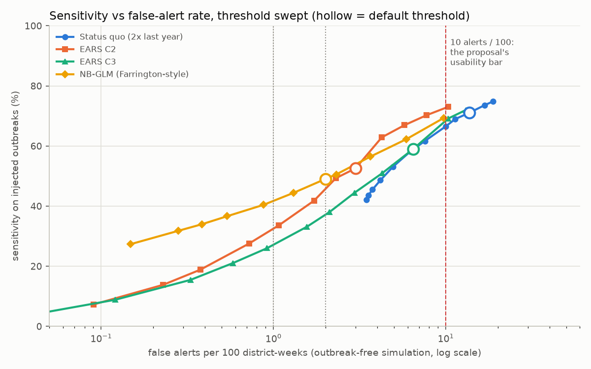
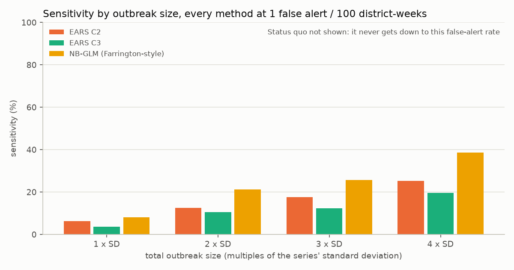
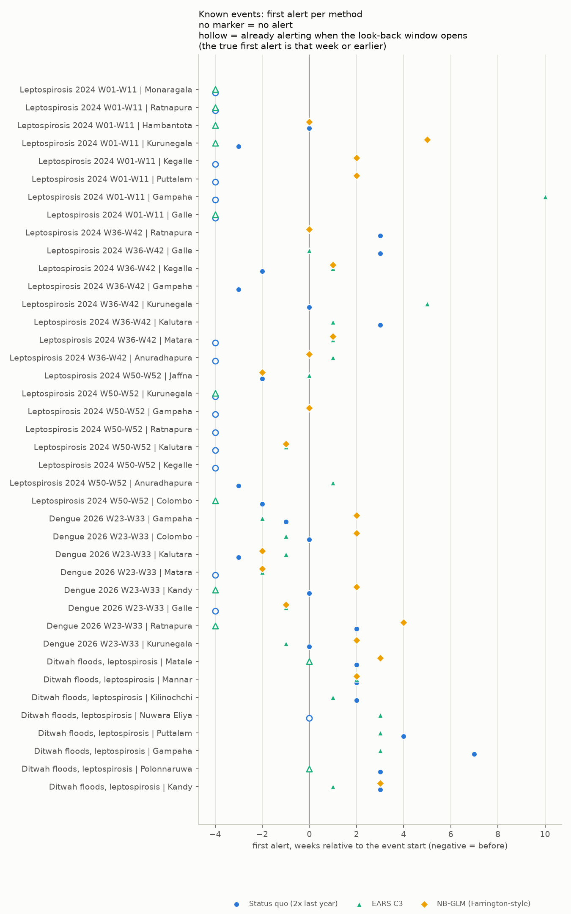
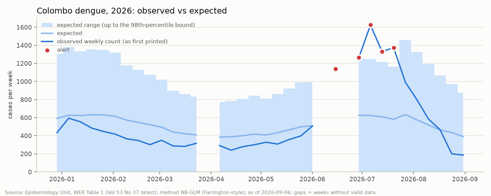
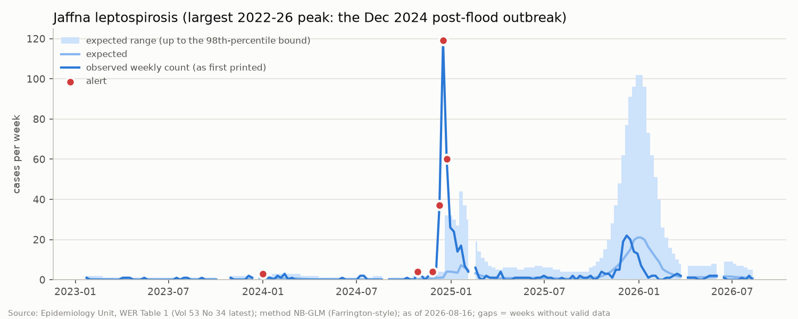
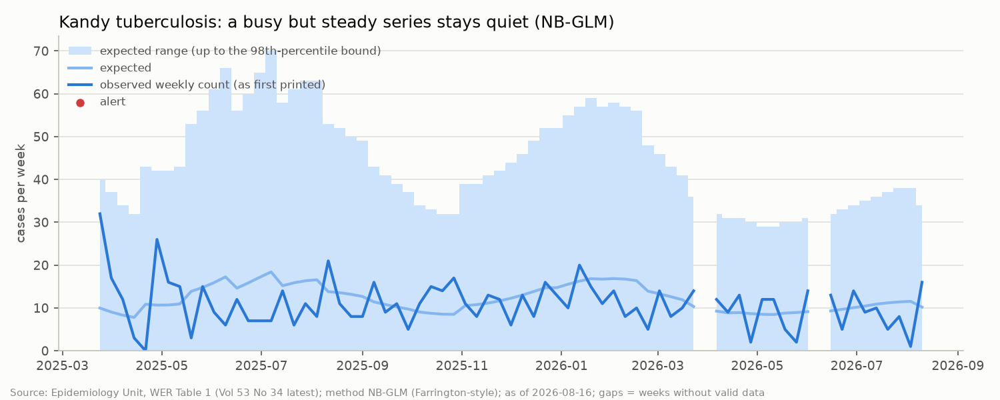

# Radar backtest

Generated 2026-11-02 by `python -m radar_lk.radar.run` then `python -m radar_lk.radar.backtest`. Primary data: Epidemiology Unit, Ministry of Health, Sri Lanka (WER Table 1); external validation: National Dengue Control Unit (NDCU) Weekly Dengue Update; rainfall: Open-Meteo (CC BY 4.0). Evaluated against the proposal's section 9 (evaluation contract).

## Highlighted finding: the source tables themselves are sometimes scrambled

> In several WER issues the weekly column of Table 1 is printed against the wrong district rows (2026-W14 and W24, every disease; chickenpox in 2026-W03 and W07) or copied unchanged from the previous week (2022-W22 and 2025-W07, whole issues; 2024-W11 chickenpox, 2024-W39 tuberculosis, 2026-W26 dengue). The national totals and cumulative columns are consistent with the wrong numbers, so every sum and cumulative check passes, and two independent extractors agree with each other because the error is in the PDF. Before this was caught, the radar was alerting on these weeks (e.g. Matale dengue 256 when the weeks around read about 20). Both patterns are now detected with past-only rules and queued (docs/EXTRACTION_REPORT.md section 5b). Anyone building on these PDFs should check for this.

## Data and design

- **Post-COVID baseline.** Only `extraction_valid` RDHS rows from **2022-W01** to 2026-W33 (Vol 53 No 34).
- **Weekly counts as first printed** in each issue, never later back-filled values.
- **Series:** 338 RDHS x disease series with >= 104 observed weeks; not modelled (insufficient history): 26 (leprosy x26).
- **No lookahead.** Every method uses only weeks before t (tested).
- **Publication lag.** A week's table appears in the WER about **8 weeks** after the week ends (median, from the PDFs' creation dates; docs/EXTRACTION_REPORT.md section 11), so these are retrospective early-warning signals on the published record.

| method | rule (default threshold) |
|---|---|
| Status quo | count >= 2 x the same week last year and >= 3 |
| EARS C2 | (y - mean) / sd > 3 over weeks t-9..t-3 (sd floored at 1) |
| EARS C3 | sum over t, t-1, t-2 of max(0, C2 - 1) > 2 |
| NB-GLM | log mu = intercept + trend + Fourier (K=2), refitted every 4 weeks on past weeks, Anscombe residual > 2.58 down-weighted; alert if y > the 98th-percentile NB bound |

Every method also needs observed >= 3. An alert in a week with `completeness_low` is suppressed (shown with the reason); a `revised` week keeps its alert with the marker.

## a) False-alert rate (outbreak-free simulation) and the default-threshold headline

For every series, 200 outbreak-free years are simulated from its own fitted NB baseline (season and trend of its last 156 weeks; 104 weeks of history then 52 evaluated weeks) and every method is run on them exactly as on real data (NB-GLM refitted every 4 weeks with down-weighting, via a batched IRLS checked against the statsmodels fit). No outbreak exists in these series, so **every alert is false**: this is the false-alert rate. It takes each series' fitted NB baseline as the truth. On the real series the NB-GLM alerts slightly LESS often than on its own null (compare the two rate columns): consistent with the real series being more over-dispersed than the fitted baseline, so the moment estimate of the dispersion widens the bound. That explanation is not proven here.

| method | default threshold | sensitivity % | sensitivity after gating % | false alerts / 100 (null) | specificity % (null) | alert rate / 100 (real data) | median delay (weeks) |
|---|---|---|---|---|---|---|---|
| Status quo (2x last year) | 2 | 71.0 | 69.8 | 13.7 | 86.3 | 10.8 | 0.0 |
| EARS C2 | 3 | 52.6 | 51.5 | 3.0 | 97.0 | 2.9 | 0.0 |
| EARS C3 | 2 | 59.0 | 57.9 | 6.5 | 93.5 | 6.0 | 0.0 |
| NB-GLM (Farrington-style) | 0.98 | 49.0 | 48.1 | 2.0 | 98.0 | 1.6 | 0.0 |

Sensitivity uses 2600 injected outbreaks (200 per disease, seed 20261104): start 2024 onwards, 1-4 weeks, total size ~ NB (dispersion 2) with mean k x the series' SD, k uniform on 1..10. Delay = weeks from outbreak start to first alert (0 = first week). **Alert rate (real data)** counts all alerts on the real series; it is not a false-alert rate, because real rises are in it.

**Usability bar.** The proposal's bar is that an alert should fire in at most 10% of district-weeks. The status-quo rule fires in 10.8 per 100 real district-weeks (13.7 per 100 even with no outbreak at all), so the rule currently used by eye would itself break that bar.

## b) Matched comparison: sensitivity at the same false-alert rate

Each method's threshold is swept (status quo factor 1.25-50; EARS C2 1-15; C3 0.5-30; NB-GLM quantile 0.80-0.9999); for each threshold the null false-alert rate and the injected-outbreak sensitivity are computed, and sensitivity is read off each curve at 1 and 2 false alerts per 100 district-weeks.

| method | sensitivity at 1 FA/100 | sensitivity at 2 FA/100 |
|---|---|---|
| Status quo (2x last year) |  |  |
| EARS C2 | 32.3 | 45.4 |
| EARS C3 | 26.9 | 37.0 |
| NB-GLM (Farrington-style) | 41.6 | 49.0 |

Sweep table (data behind the figure):

| method | threshold | null_fa_per_100 | sensitivity | median_delay |
|---|---|---|---|---|
| Status quo (2x last year) | 1.25 | 18.8 | 74.8 | 0 |
| Status quo (2x last year) | 1.5 | 16.8 | 73.6 | 0 |
| Status quo (2x last year) | 2 | 13.7 | 71 | 0 |
| Status quo (2x last year) | 2.5 | 11.3 | 69 | 0 |
| Status quo (2x last year) | 3 | 10 | 66.6 | 0 |
| Status quo (2x last year) | 4 | 7.55 | 61.7 | 0 |
| Status quo (2x last year) | 5 | 6.23 | 58.2 | 0 |
| Status quo (2x last year) | 7 | 4.92 | 53 | 0 |
| Status quo (2x last year) | 10 | 4.17 | 48.6 | 0 |
| Status quo (2x last year) | 15 | 3.75 | 45.5 | 0 |
| Status quo (2x last year) | 25 | 3.55 | 43.6 | 0 |
| Status quo (2x last year) | 50 | 3.46 | 42.2 | 0 |
| EARS C2 | 1 | 10.3 | 73 | 0 |
| EARS C2 | 1.5 | 7.71 | 70.2 | 0 |
| EARS C2 | 2 | 5.75 | 66.9 | 0 |
| EARS C2 | 2.5 | 4.25 | 62.9 | 0 |
| EARS C2 | 3 | 2.99 | 52.6 | 0 |
| EARS C2 | 3.5 | 2.3 | 49.3 | 0 |
| EARS C2 | 4 | 1.72 | 41.8 | 0 |
| EARS C2 | 5 | 1.07 | 33.6 | 0 |
| EARS C2 | 6 | 0.721 | 27.5 | 0 |
| EARS C2 | 8 | 0.376 | 18.8 | 0 |
| EARS C2 | 10 | 0.228 | 13.8 | 0 |
| EARS C2 | 15 | 0.0906 | 7.31 | 0 |
| EARS C3 | 0.5 | 13 | 72 | 0 |
| EARS C3 | 1 | 10.3 | 69.2 | 0 |
| EARS C3 | 2 | 6.47 | 59 | 0 |
| EARS C3 | 3 | 4.27 | 51 | 0 |
| EARS C3 | 4 | 2.95 | 44.5 | 0 |
| EARS C3 | 5 | 2.12 | 38.1 | 0 |
| EARS C3 | 6 | 1.56 | 33.2 | 0 |
| EARS C3 | 8 | 0.916 | 26 | 0 |
| EARS C3 | 10 | 0.58 | 21 | 0 |
| EARS C3 | 13 | 0.33 | 15.5 | 1 |
| EARS C3 | 20 | 0.121 | 8.85 | 1 |
| EARS C3 | 30 | 0.0443 | 4.38 | 1 |
| NB-GLM (Farrington-style) | 0.8 | 9.7 | 69.3 | 0 |
| NB-GLM (Farrington-style) | 0.9 | 5.91 | 62.3 | 0 |
| NB-GLM (Farrington-style) | 0.95 | 3.66 | 56.5 | 0 |
| NB-GLM (Farrington-style) | 0.975 | 2.31 | 50.5 | 0 |
| NB-GLM (Farrington-style) | 0.98 | 2 | 49 | 0 |
| NB-GLM (Farrington-style) | 0.99 | 1.3 | 44.4 | 0 |
| NB-GLM (Farrington-style) | 0.995 | 0.874 | 40.4 | 0 |
| NB-GLM (Farrington-style) | 0.998 | 0.539 | 36.7 | 0 |
| NB-GLM (Farrington-style) | 0.999 | 0.383 | 34 | 0 |
| NB-GLM (Farrington-style) | 1 | 0.279 | 31.8 | 0 |
| NB-GLM (Farrington-style) | 1 | 0.148 | 27.3 | 0 |

Status quo (2x last year) never gets below 3.5 false alerts per 100 at any threshold tried. For the status-quo rule this is structural: when last year's same week was 0, any count >= 3 alerts whatever the multiplier, so raising the factor cannot remove those alerts; its matched sensitivity is therefore undefined (blank).

By outbreak size, every method at the threshold that gives 1 false alert per 100 district-weeks (a method that cannot get that low is left blank):

| index | Status quo (2x last year) | EARS C2 | EARS C3 | NB-GLM (Farrington-style) |
|---|---|---|---|---|
| 1 x SD |  | 6.4 | 3.6 | 8.1 |
| 2 x SD |  | 12.5 | 10.5 | 21.2 |
| 3 x SD |  | 17.5 | 12.3 | 25.6 |
| 4 x SD |  | 25.2 | 19.6 | 38.6 |

Outbreaks per size: {1: 276, 2: 247, 3: 264, 4: 255}.

## c) Real-data alert rates (2024 onwards) next to the null false-alert rates

Per disease, alerts per 100 district-weeks at the default thresholds: real data, then the outbreak-free simulation. Where the real rate is far above the null rate, the series carry real rises (or model misfit); where they are close, most real alerts look like noise.

| disease | Status quo (2x last year) | EARS C2 | EARS C3 | NB-GLM (Farrington-style) | Status quo (2x last year) (null) | EARS C2 (null) | EARS C3 (null) | NB-GLM (Farrington-style) (null) |
|---|---|---|---|---|---|---|---|---|
| chickenpox | 29.5 | 4.8 | 11.7 | 1.5 | 36.1 | 4.5 | 13.0 | 3.2 |
| dengue | 25.7 | 10.6 | 23.6 | 5.7 | 31.3 | 7.8 | 19.3 | 3.6 |
| dysentery | 7.1 | 1.7 | 2.7 | 1.4 | 10.1 | 2.4 | 4.1 | 2.2 |
| encephalitis | 0.8 | 0.1 | 0.2 | 0.4 | 1.1 | 0.2 | 0.4 | 0.5 |
| enteric_fever | 0.6 | 0.2 | 0.3 | 0.4 | 0.8 | 0.3 | 0.4 | 0.5 |
| food_poisoning | 8.6 | 4.1 | 5.2 | 2.3 | 13.5 | 5.9 | 7.4 | 3.8 |
| human_rabies | 0.0 | 0.0 | 0.0 | 0.0 | 0.0 | 0.0 | 0.0 | 0.0 |
| leishmaniasis | 11.0 | 1.9 | 4.5 | 1.1 | 11.7 | 2.3 | 5.2 | 1.8 |
| leptospirosis | 22.7 | 6.5 | 14.5 | 2.2 | 28.3 | 6.1 | 15.1 | 3.1 |
| meningitis | 14.3 | 2.8 | 5.0 | 2.0 | 18.9 | 3.7 | 6.9 | 2.6 |
| tuberculosis | 19.3 | 3.6 | 7.8 | 2.4 | 18.4 | 3.7 | 8.9 | 2.7 |
| typhus | 4.0 | 0.8 | 1.9 | 0.7 | 4.2 | 1.1 | 2.2 | 1.1 |
| viral_hepatitis | 2.2 | 0.5 | 0.8 | 1.3 | 3.2 | 0.9 | 1.3 | 1.0 |

**Stop rule** (NB-GLM <= 10% of district-weeks): 1.57 per 100 at the 98th percentile; the a-priori quantile was kept.

## d) Known-event replay

Each event is located **in our data** with an explicit rule (below), not assumed. For every affected district: the first week each method alerted, from 4 weeks before the event start (from the rain week itself for Ditwah) to its end; `gain` = status-quo first week minus the method's first week (positive = earlier than the status-quo rule).

### Leptospirosis 2024, W01-W11

Rule: national weekly > 1.25 x max(2022, 2023) same week for >= 3 weeks; districts with >= 1.5 x their 2022-23 mean over the window and >= 30 excess cases.

| area | observed | reference_mean | ratio | excess |
|---|---|---|---|---|
| Monaragala | 315 | 84.50 | 3.73 | 230.50 |
| Ratnapura | 382 | 193.50 | 1.97 | 188.50 |
| Hambantota | 212 | 46.00 | 4.61 | 166.00 |
| Kurunegala | 192 | 39.50 | 4.86 | 152.50 |
| Kegalle | 230 | 86.50 | 2.66 | 143.50 |
| Puttalam | 122 | 7.00 | 17.43 | 115.00 |
| Gampaha | 148 | 37.50 | 3.95 | 110.50 |
| Galle | 223 | 115.00 | 1.94 | 108.00 |

### Leptospirosis 2024, W36-W42

Rule: national weekly > 1.25 x max(2022, 2023) same week for >= 3 weeks; districts with >= 1.5 x their 2022-23 mean over the window and >= 30 excess cases.

| area | observed | reference_mean | ratio | excess |
|---|---|---|---|---|
| Ratnapura | 301 | 97.50 | 3.09 | 203.50 |
| Galle | 209 | 88.50 | 2.36 | 120.50 |
| Kegalle | 171 | 69.00 | 2.48 | 102.00 |
| Gampaha | 157 | 67.00 | 2.34 | 90.00 |
| Kurunegala | 108 | 24.00 | 4.50 | 84.00 |
| Kalutara | 192 | 111.50 | 1.72 | 80.50 |
| Matara | 113 | 38.50 | 2.94 | 74.50 |
| Anuradhapura | 55 | 12.50 | 4.40 | 42.50 |

### Leptospirosis 2024, W50-W52

Rule: national weekly > 1.25 x max(2022, 2023) same week for >= 3 weeks; districts with >= 1.5 x their 2022-23 mean over the window and >= 30 excess cases.

| area | observed | reference_mean | ratio | excess |
|---|---|---|---|---|
| Jaffna | 216 | 1.50 | 144.00 | 214.50 |
| Kurunegala | 141 | 42.50 | 3.32 | 98.50 |
| Gampaha | 118 | 23.50 | 5.02 | 94.50 |
| Ratnapura | 140 | 71.00 | 1.97 | 69.00 |
| Kalutara | 98 | 34.00 | 2.88 | 64.00 |
| Kegalle | 81 | 38.50 | 2.10 | 42.50 |
| Anuradhapura | 72 | 31.50 | 2.29 | 40.50 |
| Colombo | 53 | 14.50 | 3.66 | 38.50 |

### Dengue 2026, W23-W33

Rule: national weekly above every same week of 2023-2025 (longest run, a single missing week bridged); districts with >= 1.5 x their 2023-25 mean and >= 100 excess cases.

| area | observed | reference_mean | ratio | excess |
|---|---|---|---|---|
| Gampaha | 9489 | 2145.00 | 4.42 | 7344.00 |
| Colombo | 9614 | 3078.33 | 3.12 | 6535.67 |
| Kalutara | 4441 | 867.00 | 5.12 | 3574.00 |
| Matara | 3458 | 437.33 | 7.91 | 3020.67 |
| Kandy | 4320 | 1879.67 | 2.30 | 2440.33 |
| Galle | 2563 | 617.00 | 4.15 | 1946.00 |
| Ratnapura | 2225 | 841.33 | 2.64 | 1383.67 |
| Kurunegala | 1785 | 627.33 | 2.85 | 1157.67 |

### After Cyclone Ditwah (rain week 2025-W48): leptospirosis

Rule: exposure = the wettest week of late 2025 in our Open-Meteo data (2025-W48, national mean 400 mm, the highest week since 2021); districts whose rain that week was >= 2 x their own 2021-26 99th percentile AND whose leptospirosis in the next 12 weeks was >= 1.5 x the same weeks of the three previous seasons.

| area | observed | reference_mean | rain_mm | rain_p99_mm | ratio | rain_x_p99 |
|---|---|---|---|---|---|---|
| Matale | 118 | 52.00 | 394.10 | 170.17 | 2.27 | 2.32 |
| Mannar | 33 | 15.33 | 382.20 | 184.10 | 2.15 | 2.08 |
| Kilinochchi | 43 | 21.67 | 490.30 | 177.34 | 1.98 | 2.76 |
| Nuwara Eliya | 91 | 46.00 | 688.00 | 256.27 | 1.98 | 2.68 |
| Puttalam | 160 | 94.33 | 501.70 | 194.31 | 1.70 | 2.58 |
| Gampaha | 247 | 147.33 | 506.40 | 222.73 | 1.68 | 2.27 |
| Polonnaruwa | 163 | 102.00 | 347.10 | 154.87 | 1.60 | 2.24 |
| Kandy | 115 | 73.67 | 449.70 | 141.35 | 1.56 | 3.18 |

### Replay table

`<=` marks a first alert in the very first week searched: the method may already have been alerting before (e.g. the early-2024 leptospirosis surge continues one that began in late 2023), so that first week is censored and its gain is left empty.

| event | district | Status quo (2x last year) first | EARS C2 first | EARS C3 first | NB-GLM (Farrington-style) first | EARS C2 gain (wk) | EARS C3 gain (wk) | NB-GLM (Farrington-style) gain (wk) |
|---|---|---|---|---|---|---|---|---|
| Leptospirosis 2024, W01-W11 | Monaragala | <=2023-W49 | <=2023-W49 | <=2023-W49 | none |  |  |  |
| Leptospirosis 2024, W01-W11 | Ratnapura | <=2023-W49 | 2023-W50 | <=2023-W49 | none |  |  |  |
| Leptospirosis 2024, W01-W11 | Hambantota | 2024-W01 | 2023-W50 | <=2023-W49 | 2024-W01 | +3 |  | +0 |
| Leptospirosis 2024, W01-W11 | Kurunegala | 2023-W50 | <=2023-W49 | <=2023-W49 | 2024-W06 |  |  | -8 |
| Leptospirosis 2024, W01-W11 | Kegalle | <=2023-W49 | none | none | 2024-W03 |  |  |  |
| Leptospirosis 2024, W01-W11 | Puttalam | <=2023-W49 | none | none | 2024-W03 |  |  |  |
| Leptospirosis 2024, W01-W11 | Gampaha | <=2023-W49 | none | 2024-W11 | none |  |  |  |
| Leptospirosis 2024, W01-W11 | Galle | <=2023-W49 | <=2023-W49 | <=2023-W49 | none |  |  |  |
| Leptospirosis 2024, W36-W42 | Ratnapura | 2024-W39 | none | none | 2024-W36 |  |  | +3 |
| Leptospirosis 2024, W36-W42 | Galle | 2024-W39 | 2024-W36 | 2024-W36 | none | +3 | +3 |  |
| Leptospirosis 2024, W36-W42 | Kegalle | 2024-W34 | 2024-W37 | 2024-W37 | 2024-W37 | -3 | -3 | -3 |
| Leptospirosis 2024, W36-W42 | Gampaha | 2024-W33 | none | none | none |  |  |  |
| Leptospirosis 2024, W36-W42 | Kurunegala | 2024-W36 | 2024-W42 | 2024-W41 | none | -6 | -5 |  |
| Leptospirosis 2024, W36-W42 | Kalutara | 2024-W39 | 2024-W37 | 2024-W37 | none | +2 | +2 |  |
| Leptospirosis 2024, W36-W42 | Matara | <=2024-W32 | 2024-W37 | 2024-W37 | 2024-W37 |  |  |  |
| Leptospirosis 2024, W36-W42 | Anuradhapura | <=2024-W32 | none | 2024-W37 | 2024-W36 |  |  |  |
| Leptospirosis 2024, W50-W52 | Jaffna | 2024-W48 | 2024-W50 | 2024-W50 | 2024-W48 | -2 | -2 | +0 |
| Leptospirosis 2024, W50-W52 | Kurunegala | <=2024-W46 | <=2024-W46 | <=2024-W46 | none |  |  |  |
| Leptospirosis 2024, W50-W52 | Gampaha | <=2024-W46 | none | none | 2024-W50 |  |  |  |
| Leptospirosis 2024, W50-W52 | Ratnapura | <=2024-W46 | none | none | none |  |  |  |
| Leptospirosis 2024, W50-W52 | Kalutara | <=2024-W46 | none | 2024-W49 | 2024-W49 |  |  |  |
| Leptospirosis 2024, W50-W52 | Kegalle | <=2024-W46 | none | none | none |  |  |  |
| Leptospirosis 2024, W50-W52 | Anuradhapura | 2024-W47 | 2024-W51 | 2024-W51 | none | -4 | -4 |  |
| Leptospirosis 2024, W50-W52 | Colombo | 2024-W48 | 2024-W47 | <=2024-W46 | none | +1 |  |  |
| Dengue 2026, W23-W33 | Gampaha | 2026-W22 | 2026-W21 | 2026-W21 | 2026-W25 | +1 | +1 | -3 |
| Dengue 2026, W23-W33 | Colombo | 2026-W23 | 2026-W22 | 2026-W22 | 2026-W25 | +1 | +1 | -2 |
| Dengue 2026, W23-W33 | Kalutara | 2026-W20 | 2026-W22 | 2026-W22 | 2026-W21 | -2 | -2 | -1 |
| Dengue 2026, W23-W33 | Matara | <=2026-W19 | 2026-W21 | 2026-W21 | 2026-W21 |  |  |  |
| Dengue 2026, W23-W33 | Kandy | 2026-W23 | <=2026-W19 | <=2026-W19 | 2026-W25 |  |  | -2 |
| Dengue 2026, W23-W33 | Galle | <=2026-W19 | 2026-W25 | 2026-W22 | 2026-W22 |  |  |  |
| Dengue 2026, W23-W33 | Ratnapura | 2026-W25 | <=2026-W19 | <=2026-W19 | 2026-W27 |  |  | -2 |
| Dengue 2026, W23-W33 | Kurunegala | 2026-W23 | 2026-W23 | 2026-W22 | 2026-W25 | +0 | +1 | -2 |
| After Cyclone Ditwah (rain week 2025-W48): leptospirosis | Matale | 2025-W50 | 2025-W51 | <=2025-W48 | 2025-W51 | -1 |  | -1 |
| After Cyclone Ditwah (rain week 2025-W48): leptospirosis | Mannar | 2025-W50 | 2025-W50 | 2025-W50 | 2025-W50 | +0 | +0 | +0 |
| After Cyclone Ditwah (rain week 2025-W48): leptospirosis | Kilinochchi | 2025-W50 | 2025-W49 | 2025-W49 | none | +1 | +1 |  |
| After Cyclone Ditwah (rain week 2025-W48): leptospirosis | Nuwara Eliya | <=2025-W48 | 2025-W51 | 2025-W51 | none |  |  |  |
| After Cyclone Ditwah (rain week 2025-W48): leptospirosis | Puttalam | 2025-W52 | 2025-W51 | 2025-W51 | none | +1 | +1 |  |
| After Cyclone Ditwah (rain week 2025-W48): leptospirosis | Gampaha | 2026-W03 | 2025-W51 | 2025-W51 | none | +4 | +4 |  |
| After Cyclone Ditwah (rain week 2025-W48): leptospirosis | Polonnaruwa | 2025-W51 | 2025-W49 | <=2025-W48 | none | +2 |  |  |
| After Cyclone Ditwah (rain week 2025-W48): leptospirosis | Kandy | 2025-W51 | 2025-W49 | 2025-W49 | 2025-W51 | +2 | +2 | +0 |

| method | district-events | method alerted | status quo alerted | comparable (both alerted, neither censored) | earlier than status quo | same week | later | median gain (wk, both alerted) |
|---|---|---|---|---|---|---|---|---|
| EARS C2 | 40 | 30 | 40 | 19 | 11 | 2 | 6 | 1.0 |
| EARS C3 | 40 | 33 | 40 | 15 | 9 | 1 | 5 | 1.0 |
| NB-GLM (Farrington-style) | 40 | 22 | 40 | 14 | 1 | 4 | 9 | -1.5 |

## e) Does completeness gating remove artefacts?

The proposal's target: alerts suppressed for low reporting completeness should be the ones that later prove to be artefacts. For every raw alert, suppressed vs kept: was the NEXT week's cumulative revised (late reports added to earlier weeks), and did the next 2 weeks stay above expected (a real rise persists)?

| method | alerts | n | next week revised % | n (revision known) | next week cum raised % (delta > 0) | median next-week revision_delta | next 2 weeks above expected % | n (2-week follow-up known) |
|---|---|---|---|---|---|---|---|---|
| Status quo (2x last year) | suppressed | 303 | 20.9 | 282 | 18.8 | 0.0 | 51.7 | 267 |
| Status quo (2x last year) | kept | 6246 | 8.3 | 5711 | 5.7 | 0.0 | 48.1 | 5240 |
| EARS C2 | suppressed | 84 | 21.5 | 79 | 19.0 | 0.0 | 57.7 | 78 |
| EARS C2 | kept | 1864 | 9.2 | 1730 | 6.2 | 0.0 | 53.0 | 1641 |
| EARS C3 | suppressed | 190 | 24.0 | 183 | 22.4 | 0.0 | 47.8 | 182 |
| EARS C3 | kept | 3847 | 10.0 | 3620 | 7.7 | 0.0 | 45.0 | 3441 |
| NB-GLM (Farrington-style) | suppressed | 41 | 8.3 | 36 | 2.8 | 0.0 | 58.3 | 36 |
| NB-GLM (Farrington-style) | kept | 1085 | 9.9 | 1003 | 5.8 | 0.0 | 50.6 | 953 |
| all methods | suppressed | 618 | 21.2 | 580 | 19.0 | 0.0 | 51.7 | 563 |
| all methods | kept | 13042 | 9.1 | 12064 | 6.4 | 0.0 | 48.1 | 11275 |

Result, all methods pooled (n = 618 suppressed vs 13042 kept alerts):

1. **The completeness flag does mark incomplete weeks.** After a suppressed alert the next week's cumulative was revised in 21% of cases vs 9% after kept alerts, and raised (late cases added) in 19% vs 6%.
2. **But the suppressed alerts do not look like artefacts.** The next 2 weeks stayed above expected after 52% of suppressed alerts vs 48% of kept ones. Late reports add cases, so a rise seen in an incomplete week is, if anything, understated, not invented.

**Verdict: the proposal's target (gating removes alerts that prove to be artefacts) is not met.** Gating holds back alerts that persist as often as the others. The dashboard therefore shows them as 'possible rise, held back: low reporting completeness' with the reason, rather than hiding them, and gating is not counted as a precision gain.
The suppressed group is small, so these percentages are imprecise.

## f) External validation: dengue radar vs NDCU 2026 high-risk MOH lists

District x week pairs in 2026 where both exist (weeks 1-33). A district is NDCU-positive when at least 1 (or 3) of its MOH areas is on the list. NDCU flags absolute burden; the radar flags what is unusual for the district and season.

### NDCU-positive = >= 1 MOH area(s) flagged

| method | district-weeks | both | radar only | NDCU only | neither | agreement % | kappa | radar sensitivity vs NDCU % | share of radar alerts with NDCU flag % | NDCU onsets | onsets with a radar alert within +-4 wk | median lag (radar - NDCU, wk) | radar earlier | same week | radar later |
|---|---|---|---|---|---|---|---|---|---|---|---|---|---|---|---|
| Status quo (2x last year) | 754 | 219 | 118 | 138 | 279 | 66.0 | 0.32 | 61.3 | 65.0 | 65 | 48 | 0.0 | 7 | 31 | 10 |
| EARS C2 | 780 | 103 | 25 | 263 | 389 | 63.1 | 0.23 | 28.1 | 80.5 | 66 | 42 | 0.0 | 6 | 20 | 16 |
| EARS C3 | 780 | 191 | 81 | 175 | 333 | 67.2 | 0.33 | 52.2 | 70.2 | 66 | 47 | 0.0 | 5 | 30 | 12 |
| NB-GLM (Farrington-style) | 780 | 120 | 14 | 246 | 400 | 66.7 | 0.31 | 32.8 | 89.6 | 66 | 28 | 0.0 | 4 | 13 | 11 |

NB-GLM pooled correlation of the weekly 0/1 series at lag L (L < 0: radar leads): L=-4: 0.07, L=-3: 0.14, L=-2: 0.22, L=-1: 0.31, L=0: 0.30, L=1: 0.31, L=2: 0.29, L=3: 0.23, L=4: 0.16. Peak at L = 1.

### NDCU-positive = >= 3 MOH area(s) flagged

| method | district-weeks | both | radar only | NDCU only | neither | agreement % | kappa | radar sensitivity vs NDCU % | share of radar alerts with NDCU flag % | NDCU onsets | onsets with a radar alert within +-4 wk | median lag (radar - NDCU, wk) | radar earlier | same week | radar later |
|---|---|---|---|---|---|---|---|---|---|---|---|---|---|---|---|
| Status quo (2x last year) | 754 | 131 | 206 | 65 | 352 | 64.1 | 0.24 | 66.8 | 38.9 | 34 | 31 | 0.0 | 3 | 22 | 6 |
| EARS C2 | 780 | 65 | 63 | 134 | 518 | 74.7 | 0.25 | 32.7 | 50.8 | 35 | 28 | 0.0 | 4 | 17 | 7 |
| EARS C3 | 780 | 123 | 149 | 76 | 432 | 71.2 | 0.32 | 61.8 | 45.2 | 35 | 34 | 0.0 | 5 | 24 | 5 |
| NB-GLM (Farrington-style) | 780 | 88 | 46 | 111 | 535 | 79.9 | 0.41 | 44.2 | 65.7 | 35 | 22 | 0.0 | 2 | 14 | 6 |

NB-GLM pooled correlation of the weekly 0/1 series at lag L (L < 0: radar leads): L=-4: 0.06, L=-3: 0.17, L=-2: 0.22, L=-1: 0.34, L=0: 0.34, L=1: 0.33, L=2: 0.30, L=3: 0.25, L=4: 0.17. Peak at L = -1.

Of the 111 district-weeks with >= 3 MOH areas flagged but no radar alert, 64% are labelled 'high burden, within expected range' on the dashboard (count in the district's own top 10% but within the expected range for the season). That is how the two signals are reconciled for the user.

## g) 2026 separately (the proposal promised this)

| method | alert rate / 100 (real 2026) | shown / 100 (2026, after gating) | sensitivity % (outbreaks starting 2026, n=552) | median delay (wk) |
|---|---|---|---|---|
| Status quo (2x last year) | 12.4 | 11.4 | 72.8 | 0.0 |
| EARS C2 | 3.2 | 2.9 | 50.9 | 0.0 |
| EARS C3 | 6.7 | 6.2 | 58.3 | 0.0 |
| NB-GLM (Farrington-style) | 2.4 | 2.3 | 46.9 | 0.0 |

2026 contains the year's dengue epidemic and the most source-table errors (four of the quarantined issues/columns), so its extraction-valid share is the lowest (see docs/EXTRACTION_REPORT.md). The 2026 dengue replay is in section d, the NDCU comparison in f.

## h) Case studies, track record, persistence and burden

`data/clean/radar_signals.parquet` carries, per series-week and method: `weeks_persisted` (consecutive weeks up to and including this one above the bound; past weeks only), `sustained` (>= 2), `burden_pctl` (percentile of the count among the district's own past counts) and `burden_label` ('unusual for this district and season', 'high burden, within expected range', or held back for low completeness). `radar_track_record.parquet` has the per-series alert counts and the share followed by a second high week.

NB-GLM: 1085 shown alerts; 25% sustained (>= 2 weeks); 25% followed by a second high week. Weeks persisted: {1: 809, 2: 148, 3: 67, 4: 34, 5: 11, 6: 4}.

## Deviations from the proposal

| proposal | this build | why |
|---|---|---|
| Baselines from 2016 | From **2022-W01** | Post-COVID baseline: 2020-21 reporting was distorted, and 2016-21 PDFs were not processed in the compressed schedule. Seasonal terms rest on 1-4 seasons. |
| Farrington Flexible (R `surveillance`) | **NB-GLM with Farrington-style down-weighting** (Anscombe residual > 2.58 -> weight r^-2), refitted every 4 weeks, in Python | No R in the build; the method keeps Farrington's key ideas (NB, trend, seasonality, outbreak down-weighting) but not its exact seasonal factor or its trend-dropping rule. |
| Threshold chosen in evaluation | The **98th percentile fixed a priori** and never tuned; the sweep in section b only shows what other thresholds would give | Avoids optimising on the test data. |
| Rates per population | **Counts**, not rates; population denominators not yet added | District populations were not ingested; signals are relative to each district's own history, so the radar does not need them, but maps of burden would. |
| Real false-alert rate from labelled data | False-alert rate from **outbreak-free simulation** of each series' fitted baseline; real-data alert rate reported separately | There are no labelled outbreak/non-outbreak weeks. |

## Limitations

- The null simulation takes each series' fitted NB baseline as the truth; real series that depart from that model change the false-alert rate in either direction (section c).
- Injected outbreaks are synthetic; real events of other shapes may be detected differently.
- Known events are located from the same counts the radar uses (for Ditwah also from rainfall); the replay measures timing against the status-quo rule, not against an independent truth.
- NB bounds ignore parameter uncertainty; TB starts in 2024, so its NB-GLM predicts only from 2025.
